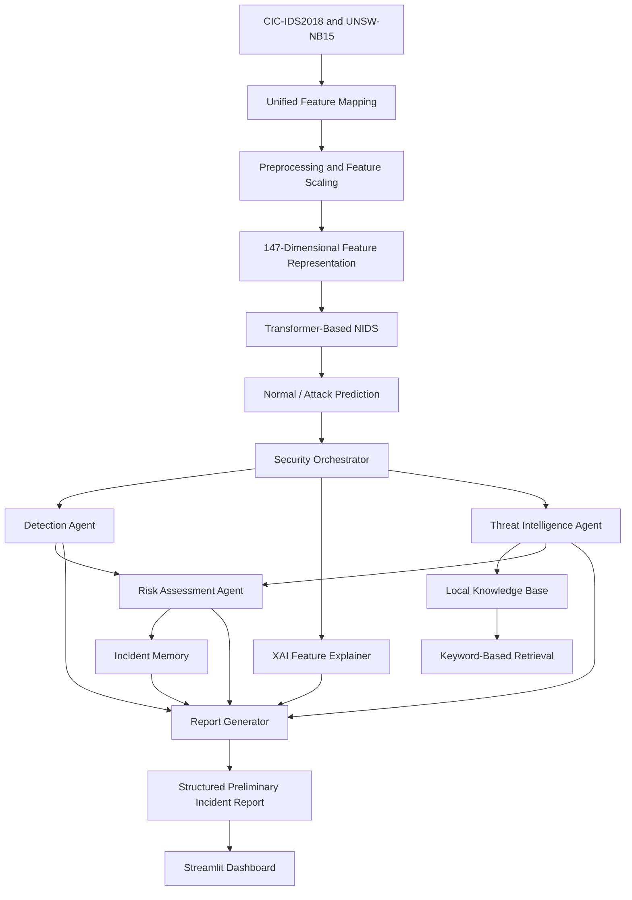

# Agentic Threat Intelligence Framework for Network Intrusion Detection Using Transformer-Based Traffic Analysis with Explainable AI and Retrieval-Augmented Generation

A research-oriented **Network Intrusion Detection System (NIDS)** that combines Transformer-based traffic classification, multi-agent security orchestration, Explainable Artificial Intelligence (XAI), local threat-intelligence retrieval, risk assessment, and structured incident reporting.

The project aims to support cybersecurity analysts by transforming network-flow predictions into interpretable, contextualized, and actionable preliminary security reports.

> **Project status:** Phase 2 demo implementation completed and tested. The system currently analyzes preprocessed network-flow records through dataset replay. It is not a live packet-capture sensor or an autonomous attack-prevention system.

---

## 1. Problem Statement

Traditional Network Intrusion Detection Systems face several challenges, including:

- High volumes of network traffic.
- Constantly evolving attack patterns.
- False-positive and false-negative alerts.
- Limited interpretability of machine-learning predictions.
- Difficulty connecting detection results with relevant threat intelligence.
- Time-consuming manual incident investigation and reporting.

Although machine-learning-based intrusion detection can identify suspicious network activity, a prediction alone may not provide sufficient information for security analysts to understand the evidence, assess the potential impact, or decide on appropriate investigative actions.

This project addresses these challenges by integrating a Transformer-based intrusion detection model with an agentic security-analysis workflow, explainability, threat-intelligence retrieval, and preliminary incident reporting.

---

## 2. Project Objectives

### Objective 1: Unified Feature Representation

Develop a unified feature mapping framework that transforms the CIC-IDS2018 and UNSW-NB15 datasets into a common network-flow feature space.

### Objective 2: Transformer-Based Detection and Agentic Analysis

Develop a Transformer-based binary intrusion detection model and integrate it with a multi-agent security orchestration framework for detection, threat analysis, risk assessment, and reporting.

### Objective 3: Explainable and Context-Aware Threat Intelligence

Integrate Explainable AI and Retrieval-Augmented Generation concepts to provide feature-level explanations, relevant security references, and evidence-based preliminary incident reports.

---

## 3. Key Features

### Transformer-Based Intrusion Detection

- Binary classification of network traffic into **Normal** and **Attack**.
- Transformer encoder architecture for tabular network-flow features.
- 147-dimensional processed input representation.
- GPU-accelerated inference using PyTorch and CUDA when available.
- Prediction confidence and class probabilities.

### Multi-Agent Security Orchestration

A centralized Security Orchestrator coordinates:

- Detection Agent.
- Threat Intelligence Agent.
- Risk Assessment Agent.
- Memory Agent.
- Report Generator.
- Explainable AI module.

### Explainable Artificial Intelligence

- Gradient × Input feature attribution.
- Identification of influential model features.
- Top-feature explanations for individual predictions.
- Explanation status tracking.

Feature attribution describes model behavior; it does not independently establish the cause of a network attack.

### Local Threat-Intelligence Retrieval

- Local knowledge base containing security-reference summaries.
- Keyword-based retrieval of relevant information.
- Source traceability.
- Contextual guidance based on detection results.

**Current implementation note:** The retrieval component does not use a generative Large Language Model. It retrieves relevant local documents and incorporates their references into structured analysis and reports.

### Risk Assessment

- LOW, MEDIUM, and HIGH risk categories.
- Normal predictions generally receive LOW risk.
- Attack predictions generally receive MEDIUM risk.
- HIGH risk requires explicitly supplied critical indicators.

Model confidence alone does not establish incident severity or confirmed compromise.

### Incident Memory and Reporting

- JSONL-based incident history.
- Structured preliminary incident reports.
- Detection and confidence information.
- XAI explanations.
- Threat-intelligence references.
- Risk assessment.
- Investigation and mitigation recommendations.

### Interactive Streamlit Dashboard

- Dataset-replay-based traffic analysis.
- Normal and Attack prediction monitoring.
- Prediction confidence visualization.
- Ground-truth comparison for experimental evaluation.
- Feature-level explanations.
- Threat-intelligence references.
- Risk assessment and reporting.
- Historical analysis and dashboard statistics.

The dashboard processes stored network-flow samples rather than capturing live packets.

---

## 4. System Architecture



The diagram represents the logical workflow. Detection, explanation, retrieval, risk assessment, and reporting are coordinated through the implemented Security Orchestrator.

---

## 5. Technology Stack

| Category | Technologies |
|---|---|
| Programming language | Python |
| Deep learning | PyTorch |
| Detection architecture | Transformer Encoder |
| Data processing | Pandas, NumPy |
| Machine learning utilities | Scikit-learn |
| Preprocessing | StandardScaler, one-hot encoding |
| Explainable AI | Gradient × Input |
| Threat intelligence | Local knowledge base and keyword retrieval |
| Backend orchestration | Python-based multi-agent architecture |
| Dashboard | Streamlit |
| Visualization | Streamlit charts and data displays |
| Testing | Pytest |
| Model acceleration | CUDA, when available |
| Version control | Git and GitHub |

---

## 6. Datasets

The project uses two publicly available intrusion detection datasets:

### CIC-IDS2018

Provides network-flow records representing benign traffic and attack scenarios.

### UNSW-NB15

Provides labeled network traffic containing Normal records and multiple attack categories.

### Dataset Integration Strategy

The current dataset construction uses:

**Training dataset:**
- CIC-IDS2018 records.
- UNSW-NB15 training records.

**Testing dataset:**
- UNSW-NB15 testing records.

The original UNSW-NB15 testing file is not concatenated into the training dataset.

### Unified Feature Representation

Both datasets are transformed into a common semantic feature space containing network-flow attributes such as:

- Protocol.
- Flow duration.
- Source and destination packet counts.
- Source and destination byte counts.
- Mean packet sizes.
- Inter-arrival times.
- TCP window values.
- Packet rates.
- Byte rates.

Protocol values are normalized and one-hot encoded.

The resulting processed feature representation contains **147 model input features**.

Metadata fields such as `dataset_source` and `attack_category` are excluded from the model inputs.

---

## 7. Transformer Model Architecture

The intrusion detection model uses a Transformer encoder for tabular data.

| Parameter | Configuration |
|---|---|
| Input features | 147 |
| Embedding dimension | 64 |
| Attention heads | 4 |
| Transformer encoder layers | 3 |
| Feedforward dimension | 128 |
| Dropout | 0.1 |
| Output classes | 2 |
| Class 0 | Normal |
| Class 1 | Attack |

### Processing Workflow

1. Each scalar input feature is projected into an embedding vector.
2. Learnable feature-position embeddings are added.
3. Embedded features pass through Transformer encoder layers.
4. Encoded feature representations are aggregated using mean pooling.
5. Layer normalization and a classification head produce two output logits.
6. Softmax converts logits into Normal and Attack probabilities.

The model performs **binary intrusion detection**, not multiclass attack-family classification.

---

## 8. Multi-Agent Framework

### Detection Agent

Receives the Transformer prediction, confidence, and class probabilities.

### Threat Intelligence Agent

Analyzes available numerical traffic observations and retrieves relevant references from the local knowledge base.

The agent does not treat ground-truth labels as evidence available during inference.

An Attack prediction does not automatically establish a specific attack family.

### Risk Assessment Agent

Assigns preliminary risk levels using the detection output and explicitly supplied threat indicators.

The implemented rules distinguish between model suspicion and independently supplied critical indicators.

### Memory Agent

Stores incident-analysis records for subsequent inspection and reporting.

### Report Generator

Consolidates detection, XAI, threat-intelligence retrieval, risk assessment, and memory information into a structured preliminary report.

### Security Orchestrator

Coordinates the complete analysis workflow and provides the integrated output consumed by the dashboard.

---

## 9. Explainable AI

The implemented XAI module uses **Gradient × Input** attribution.

For an input feature, the method combines its value with the gradient of the selected model score with respect to that feature.

This helps identify features that influenced a particular prediction.

### Interpretation Limitations

- Attribution values are not causal explanations.
- High attribution does not prove malicious activity.
- Explanations depend on the model and input representation.
- Feature importance should be interpreted alongside traffic evidence and analyst judgment.

---

## 10. Retrieval-Augmented Threat Intelligence

The local retrieval pipeline uses project-authored security-reference summaries.

The retrieval workflow:

1. Receives investigation context.
2. Searches the local knowledge base.
3. Calculates keyword-overlap relevance scores.
4. Returns relevant documents and source references.
5. Incorporates retrieved information into preliminary analysis and reporting.

### Knowledge Base References

- [NIST SP 800-61 Rev. 3 — Incident Response](https://csrc.nist.gov/pubs/sp/800/61/r3/final)
- [MITRE ATT&CK](https://attack.mitre.org/)

Retrieved documents provide contextual guidance. They do not independently confirm a specific attack, attacker technique, or compromise.

The current system does not generate new threat-intelligence narratives using an LLM.

---

## 11. Experimental Evaluation

The existing Transformer checkpoint was evaluated on **175,341 UNSW-NB15 test samples**.

### Binary Classification Performance

| Metric | Recorded Result |
|---|---:|
| Evaluation samples | 175,341 |
| Accuracy | 87.46% |
| Attack precision | 87.92% |
| Attack recall | 94.56% |
| Attack F1-score | 91.12% |
| Specificity | 72.32% |
| False-positive rate | 27.68% |
| False-negative rate | 5.44% |

### Confusion Matrix

| Actual / Predicted | Normal | Attack |
|---|---:|---:|
| Normal | 40,500 | 15,500 |
| Attack | 6,488 | 112,853 |

**Interpretation:**

- 112,853 attack samples were correctly identified.
- 6,488 attack samples were incorrectly classified as Normal.
- 40,500 Normal samples were correctly classified.
- 15,500 Normal samples were incorrectly flagged as Attack.

The false-positive rate is a significant limitation for operational deployment because excessive alerts can increase analyst workload.

### Important Evaluation Limitation

The existing training implementation selected the best model checkpoint using F1-score calculated on the test dataset.

Therefore, the reported test metrics are **preliminary and subject to checkpoint-selection bias**. They should not be interpreted as an unbiased independent estimate of generalization performance.

A corrected validation-based training workflow has been implemented separately, but a replacement model has not yet been fully trained and independently evaluated.

---

## 12. Attack-Category Error Analysis

The binary classifier's missed Attack predictions were analyzed using the original test-set attack-category labels.

These categories were used for **offline error analysis only** and were not supplied as model input features.

| Attack Category | Total Attacks | Missed Attacks | Miss Rate |
|---|---:|---:|---:|
| Fuzzers | 18,184 | 3,962 | 21.79% |
| Exploits | 33,393 | 1,415 | 4.24% |
| DoS | 12,264 | 589 | 4.80% |
| Analysis | 2,000 | 179 | 8.95% |
| Shellcode | 1,133 | 142 | 12.53% |
| Generic | 40,000 | 110 | 0.28% |
| Backdoor | 1,746 | 42 | 2.41% |
| Reconnaissance | 10,491 | 38 | 0.36% |
| Worms | 130 | 11 | 8.46% |

### Key Findings

- Fuzzers produced the highest number of missed attacks: **3,962**.
- Fuzzers accounted for approximately **61% of all false negatives**.
- Shellcode had a miss rate of **12.53%**.
- Generic and Reconnaissance had comparatively low miss rates.
- Category-level performance varies considerably, indicating areas for future model improvement.

Detailed results are saved in:

```text
evaluation_results/attack_category_error_analysis.csv
```

Additional evaluation artifacts include:

```text
evaluation_results/evaluation_metrics.json
evaluation_results/confusion_matrix.csv
evaluation_results/attack_family_metrics.json
```

The `attack_family_metrics.json` file documents limitations of the earlier heuristic attack-family analysis. It is not evidence of a validated multiclass classifier.

---

## 13. Validation-Based Training Workflow

A separate training workflow has been implemented to address test-set-based checkpoint selection.

File:

```text
detection_engine/training/train_validated.py
```

### Improvements

- Stratified training/validation split.
- Reproducible random seed.
- Training-partition-only median imputation.
- Training-partition-only StandardScaler fitting.
- Validation F1-based checkpoint selection.
- Separate checkpoint and preprocessing artifacts.
- No access to the independent test dataset during training.

### Verified Dry Run

The validation pipeline completed its dry run successfully.

| Item | Result |
|---|---:|
| Training records | 904,725 |
| Validation records | 226,182 |
| Input features | 147 |
| Environment | CUDA available |
| Dry-run status | Passed |

### Dry-Run Command

```powershell
python -m detection_engine.training.train_validated --dry-run
```

This checks data preparation without training the model or writing new checkpoint artifacts.

### Full Training Command

```powershell
python -m detection_engine.training.train_validated --epochs 5
```

**Note:** Full training has not yet been completed for this corrected workflow. Its checkpoint must be paired with its own saved preprocessing artifacts before use in inference.

The current dashboard continues to use the existing trained checkpoint.

A row-level stratified split also does not guarantee that duplicate or closely related flows are isolated between partitions. Further dataset-integrity checks are recommended.

---

## 14. Streamlit Dashboard

The project includes an interactive Streamlit dashboard for replaying and analyzing preprocessed network-flow samples.

### Dashboard Capabilities

- Dataset sample selection and replay.
- Transformer inference.
- Prediction confidence and probabilities.
- Normal/Attack detection monitoring.
- Ground-truth comparison during evaluation.
- Feature attribution visualization.
- Local threat-intelligence retrieval.
- Risk assessment.
- Preliminary incident reporting.
- Analysis history.

### Launch the Dashboard

From the repository root:

```powershell
python -m streamlit run app.py
```

Streamlit will provide a local URL, typically:

```text
http://localhost:8501
```

The application requires the appropriate dependencies, processed data, and existing trained checkpoint.

### Dashboard Scope

The dashboard is a **dataset-replay research interface**.

It does not currently:

- Capture packets from a live network interface.
- Inspect real-time network traffic directly.
- Block malicious connections.
- Automatically quarantine devices.
- Execute security mitigation actions.

---

## 15. Repository Structure

```text
Agentic-Threat-Intelligence-NIDS/
|
|-- app.py
|-- evaluate_phase2.py
|-- evaluate_attack_family.py
|
|-- detection_engine/
|   |-- models/
|   |   |-- tabular_transformer.py
|   |   |-- best_transformer.pt
|   |
|   |-- inference/
|   |   |-- predict.py
|   |
|   |-- training/
|   |   |-- dataset.py
|   |   |-- train.py
|   |   |-- train_validated.py
|   |
|   |-- evaluation/
|       |-- evaluate.py
|
|-- security_orchestrator/
|   |-- agents/
|   |-- rag/
|   |   |-- knowledge_base/
|   |   |-- retriever.py
|   |   |-- knowledge_base_loader.py
|   |
|   |-- reporting/
|   |   |-- report_generator.py
|   |
|   |-- xai/
|   |   |-- feature_explainer.py
|   |
|   |-- tests/
|   |-- orchestrator.py
|
|-- utfh/
|   |-- mappers/
|   |   |-- feature_mapper.py
|   |   |-- merge_datasets.py
|   |
|   |-- preprocessing/
|       |-- preprocess.py
|
|-- datasets/
|   |-- raw/
|   |-- merged/
|   |-- processed/
|
|-- evaluation_results/
|   |-- evaluation_metrics.json
|   |-- confusion_matrix.csv
|   |-- attack_category_error_analysis.csv
|
|-- README.md
```

Large datasets and model checkpoints may not be included in a fresh repository clone.

---

## 16. Installation and Setup

### Prerequisites

- Python compatible with the installed PyTorch version.
- Git.
- Windows PowerShell or another supported terminal.
- Required Python dependencies.
- Trained model checkpoint and processed datasets for inference.
- CUDA-compatible GPU (optional).

### Clone the Repository

```powershell
git clone https://github.com/aneegthub17/Agentic-Threat-Intelligence-NIDS.git
cd Agentic-Threat-Intelligence-NIDS
```

### Create a Virtual Environment

```powershell
py -m venv .venv
```

### Activate the Environment

```powershell
.\.venv\Scripts\Activate.ps1
```

### Upgrade Pip

```powershell
python -m pip install --upgrade pip
```

### Install Dependencies

If the repository contains a dependency manifest:

```powershell
python -m pip install -r requirements.txt
```

Otherwise, install the principal dependencies used by the current project:

```powershell
python -m pip install torch pandas numpy scikit-learn joblib streamlit streamlit-autorefresh pytest
```

For GPU acceleration, install a PyTorch build compatible with the machine's GPU and CUDA environment using the official PyTorch installation instructions.

### Required Dataset Files

The mapping pipeline expects:

```text
datasets/raw/CICIDS2018/cic.csv
datasets/raw/UNSW-NB15/UNSW_NB15_training-set.csv
datasets/raw/UNSW-NB15/UNSW_NB15_testing-set.csv
```

### Rebuild Merged Data

```powershell
python utfh/mappers/merge_datasets.py
```

Before regenerating data, verify the mapper import path in `merge_datasets.py`. An earlier version contains a directory-name typo (`ut fh` instead of `utfh`).

### Preprocess Data

```powershell
python utfh/preprocessing/preprocess.py
```

This creates the processed training and testing datasets and the fitted scaler.

**Warning:** Rebuilding data can overwrite existing artifacts. Preserve the working datasets and checkpoint before rerunning preprocessing or training.

---

## 17. Running Model Evaluation

The Phase 2 evaluation script performs binary classification evaluation and saves result artifacts.

```powershell
python evaluate_phase2.py
```

The evaluation uses the existing checkpoint and processed test dataset.

An additional evaluation script is available:

```powershell
python detection_engine/evaluation/evaluate.py
```

Its threshold comparison is descriptive only. Selecting a deployment threshold should be performed using validation data, not the test dataset.

---

## 18. Automated Testing

The project uses Pytest to verify its components and integrations.

### Run All Tests

```powershell
python -m pytest -q
```

### Latest Verified Test Result

```text
59 passed, 5 warnings in 15.11s
```

The five warnings relate to PyTorch's nested-tensor optimization and the Transformer's `norm_first=True` configuration. They did not cause test failures.

Tests cover the implemented security orchestration, detection, explanations, retrieval, reporting, and related integration behavior.

Passing tests verify the tested software behavior; they do not establish production security readiness or independent model generalization.

---

## 19. Main Research Contributions

The project demonstrates the integration of several cybersecurity analysis components into a unified workflow.

### Unified Network-Flow Representation

Maps two intrusion detection datasets into a common feature representation.

### Transformer-Based Binary Detection

Applies a Transformer encoder to tabular network-flow features.

### Agentic Security Analysis

Coordinates detection, threat context, risk assessment, memory, and reporting.

### Explainability

Provides feature-level attribution to support interpretation of model predictions.

### Retrieval-Based Threat Intelligence

Connects detection results to traceable local security references.

### Preliminary Incident Reporting

Consolidates model outputs and available evidence into structured reports.

### Experimental Error Analysis

Evaluates binary detection performance and identifies attack categories with elevated miss rates.

---

## 20. Limitations

The current implementation has several important limitations:

1. **No live packet capture:** The dashboard replays stored network-flow records.
2. **Binary detection only:** The Transformer predicts Normal or Attack, not a specific attack family.
3. **Preliminary evaluation:** The existing checkpoint was selected using test-set F1.
4. **False-positive rate:** The recorded false-positive rate is 27.68%.
5. **False negatives:** Some attacks, especially Fuzzers and Shellcode samples, are missed.
6. **Local keyword retrieval:** The RAG component does not currently generate answers using an LLM.
7. **Explanation limitations:** Gradient × Input attributions are not causal evidence.
8. **No automated response:** The system does not block, quarantine, or remediate attacks.
9. **Dataset generalization:** Evaluation on the current UNSW test set does not establish performance across all real-world networks.
10. **Risk assessment:** Critical indicators depend on explicitly supplied information and are not independently verified by the risk-assessment module.

The system is intended as an academic research prototype and decision-support tool, not a production-grade security monitoring platform.

---

## 21. Future Enhancements

Potential improvements include:

- Complete training using the corrected validation workflow.
- Independently evaluate the new checkpoint.
- Investigate and reduce false-positive rates.
- Improve detection of Fuzzers and Shellcode attack samples.
- Perform duplicate and related-flow leakage checks.
- Explore improved feature selection and model calibration.
- Add live network traffic capture and flow extraction.
- Investigate multiclass attack-family classification.
- Introduce embedding-based retrieval and optional LLM-assisted reporting.
- Expand the threat-intelligence knowledge base.
- Improve risk assessment using independently verified evidence.
- Evaluate the quality and stability of XAI explanations.
- Benchmark against traditional machine-learning and deep-learning baselines.
- Conduct broader cross-dataset and real-world validation.

---

## 22. Project Status

| Component | Status |
|---|---|
| Unified feature mapping | Completed |
| Dataset preprocessing | Completed |
| Transformer binary classifier | Implemented |
| GPU inference | Tested |
| Security Orchestrator | Implemented |
| Detection Agent | Implemented |
| Threat Intelligence Agent | Implemented |
| Risk Assessment Agent | Implemented |
| Memory Agent | Implemented |
| Gradient × Input XAI | Integrated |
| Local threat-intelligence retrieval | Integrated |
| Preliminary report generation | Implemented |
| Streamlit dashboard | Implemented and tested |
| Binary model evaluation | Completed for existing checkpoint |
| Attack-category error analysis | Completed |
| Validation-based training script | Implemented; dry run passed |
| Corrected model retraining | Pending |
| Independent evaluation of corrected checkpoint | Pending |
| Automated regression tests | 59 passed |
| Live traffic monitoring | Future scope |

---

## 23. Responsible Use

This project is intended for academic research, cybersecurity education, and authorized defensive network analysis.

Model predictions, feature attributions, risk levels, and retrieved references should be reviewed by qualified analysts.

The system must not be treated as definitive evidence of compromise or used as the sole basis for consequential security decisions.

Use only datasets and network traffic that you are authorized to access and analyze.

---

## 24. License and Attribution

Dataset licensing and attribution requirements should be reviewed before redistributing dataset files or derived artifacts.

A repository license should be added once the project authors select the appropriate terms.

---

## Repository

**GitHub:** https://github.com/aneegthub17/Agentic-Threat-Intelligence-NIDS

**Project:** Agentic Threat Intelligence Framework for Network Intrusion Detection Using Transformer-Based Traffic Analysis with Explainable AI and Retrieval-Augmented Generation

**Current milestone:** Phase 2 research prototype and demonstration implementation.
